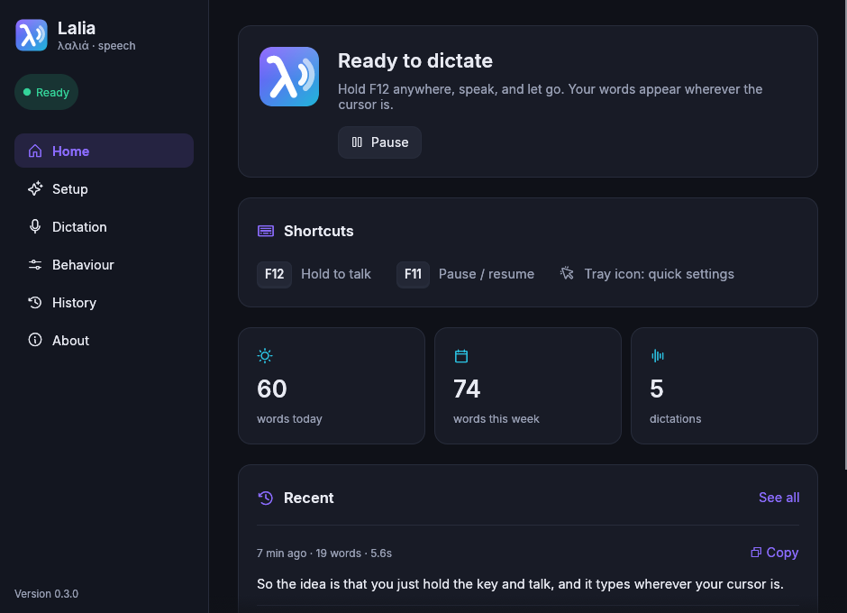

<p align="center"></p>

# Lalia

[](https://github.com/Nikish-codes/lalia/actions/workflows/ci.yml)
[](LICENSE)
[](https://www.rust-lang.org)

**System-wide live dictation for Linux (X11).** From Greek **λαλιά** = *"speech, talk"*.

Hold **F12**, speak, and the text is typed straight into **whatever window is
focused** — browser, editor, terminal, chat, anywhere. Release to finish.
Lalia lives in your **system tray**, and while you talk **Lali** — a tiny
animated buddy — bobs along to your voice and shows the words it hears. There's a
**settings window** with a guided first-run setup.

<p align="center"></p>



It runs on **Gemini 3.5 Transcribe Live** — the exact model and technique
Antigravity's record button uses (the Live API's `BidiGenerateContent` +
`inputAudioTranscription`).

```
F12 held ──► mic ──► 16 kHz PCM ──► Gemini 3.5 Transcribe Live (WebSocket)
                                            │ interim / final transcripts
F12 released ──► xdotool types text ────────┘  into the focused window
```

## Install

### Option A — .deb (one command)

Download the latest `.deb` from the
[**Releases page**](https://github.com/Nikish-codes/lalia/releases), then:

```bash
sudo apt install ./lalia_0.3.1_amd64.deb    # or: sudo dpkg -i lalia_*.deb
```

Open **Lalia** from your applications menu. The first time, a setup window asks
for your Gemini API key (it checks the key for you), lets you test your
microphone and pick your keys, and gives you a box to try dictating into.

Build the package yourself with `./packaging/build-deb.sh` (output in `dist/`).

### Option B — from source

```bash
sudo apt install -y xdotool libasound2-dev pkg-config
cargo build --release
sudo install -m755 target/release/lalia /usr/local/bin/lalia
lalia
```

or just `./install.sh` (installs to `~/.local/bin` and adds a menu entry).

You need a Gemini API key: <https://aistudio.google.com/apikey>.
The free tier covers this model at **$0**.

## Features

| Feature | How |
|---|---|
| **Tray icon** | Colour shows the state (ready, listening, paused, needs setup). Left-click: settings. Middle-click: pause. Menu: mode, typing, hotkey style, recent dictations, start on login |
| **Lali, the dictation buddy** | A small animated character that listens, mouths along, ripples with your voice, thinks, celebrates and naps (paused). Your words unroll in a speech bubble. Click-through, never steals focus. Prefer something quieter? `overlay_style = "pill"` |
| **Settings window** | Guided setup, all options, searchable history, light and dark themes |
| **Push-to-talk or toggle** | `activation = "hold"` (default) or `"toggle"` — tap to start/stop |
| **Pause everything** | Tap **F11** to pause/resume; F12 is inert while paused |
| **Any key you like** | F1–F35, Pause, Scroll Lock, Insert, Menu, Right Ctrl, Right Alt, Right Super |
| **Streaming or on-release insert** | Type phrases as you speak, or type the whole thing at the end |
| **Verbatim or smart** | `VERBATIM` (raw) or `SMART` (punctuation, casing, filler removal, lists) |
| **Custom vocabulary** | Bias recognition toward names/jargon (`vocabulary = [...]`) |
| **Language hints / auto-detect** | `language = "en-US"` or `""` for auto |
| **Microphone choice** | Pick an input device; test it with a live meter |
| **History** | Every dictation saved locally; copy any of them again from the window or tray |
| **Command line control** | `lalia toggle` — bind it to any shortcut in your desktop settings |
| **Start on login** | `lalia autostart enable` or the toggle in the window/tray |
| **Single instance** | Launching Lalia again opens its settings window |

## Usage

```bash
lalia                    # run in the tray (opens setup the first time)
lalia gui [page]         # settings window: home|setup|dictation|feedback|history|about
lalia toggle             # start/stop dictation in the running Lalia
lalia pause | resume     # same as F11
lalia status             # state as JSON
lalia quit
lalia selftest 8         # capture 8s, print transcripts, type nothing
lalia set-key            # store the API key from stdin (0600)
lalia config             # show resolved settings + paths
lalia generate-config    # write a commented ~/.config/lalia/config.toml
lalia autostart enable|disable|status
lalia help
```

## Configuration

Everything is in the settings window. It saves to `~/.config/lalia/config.toml`
and the running Lalia picks up changes within a second (hand edits too):

```toml
hotkey = "F12"           # dictate key (F1–F35, Pause, ScrollLock, Insert, Menu, RightCtrl, RightAlt, RightSuper)
pause_hotkey = "F11"     # pause/resume key
activation = "hold"      # "hold" | "toggle"
insert = "streaming"     # "streaming" | "on_release"
mode = "VERBATIM"        # "VERBATIM" | "SMART"
language = ""            # e.g. "en-US", empty = auto-detect
vocabulary = []          # e.g. ["Kubernetes", "ConnectRPC"]
model = "gemini-3.5-transcribe-live"
input_device = ""        # microphone name, empty = system default
type_delay_ms = 2        # raise to 4-6 if an app drops characters
overlay = true           # on-screen indicator while dictating
overlay_position = "bottom"
overlay_style = "buddy"  # "buddy" (Lali, needs desktop effects) | "pill"
notify = true
sound = true
history = true           # keep a local history (~/.local/share/lalia)
start_enabled = true     # false = start paused
```

Environment variables override the file (`LALIA_HOTKEY`, `LALIA_MODE`,
`LALIA_VOCAB`, `LALIA_ACTIVATION`, `LALIA_OVERLAY`, `GEMINI_API_KEY`, …). See `lalia help`.

## Run on login

```bash
lalia autostart enable     # writes ~/.config/autostart/lalia.desktop
lalia autostart status
```

Lalia starts inside your desktop session (so it gets the right display and the
tray). Older versions used a systemd user unit; enabling or disabling removes it.

## Troubleshooting

* **No tray icon on GNOME** → install/enable the *AppIndicator and KStatusNotifierItem
  Support* extension (Ubuntu ships it). Cinnamon, KDE, XFCE and MATE show it out of the box.
* **"Microphone unavailable"** → pick another input in *Dictation → Microphone* and
  press *Test microphone*.
* **"API key problem"** → *Setup → Connect to Gemini*, paste a new key, *Verify & save*.
* **Text lands in the wrong place** → click the target field first; xdotool types
  into the *focused* window.
* **Characters dropped in some apps** → *Dictation → Advanced → Typing speed* (4–6 ms).
* **Nothing transcribed** → `lalia selftest 8`; if you don't see `ready
  (streaming)`, it's the key/model (the error is printed).
* **Paused by accident** → tap the pause key (F11); the indicator tells you.

## Requirements

Linux with **X11** (verified on Cinnamon). `xdotool` for typing, `libasound2`
for audio, OpenGL (Mesa) for the settings window, `libnotify-bin` /
`libcanberra-gtk3-module` optional for notifications and sound. **Wayland** is
not supported yet (needs the GlobalShortcuts portal + `wtype`).

## Layout

```
src/main.rs       CLI entry point and subcommands
src/app.rs        the daemon: state machine, sessions, control socket, config reload
src/hotkey.rs     global hotkeys (X11 keymap polling, no key grab), live re-binding
src/audio.rs      mic capture (cpal) → downmix + resample → 16 kHz mono PCM16, level meter
src/gemini.rs     Live API WebSocket: setup, stream audio, parse interim/final, key check
src/inject.rs     ordered typing queue (xdotool) + segment spacing
src/tray.rs       system-tray icon and menu (StatusNotifierItem)
src/overlay.rs    on-screen indicator window (raw X11, click-through) + the pill style
src/buddy.rs      Lali, the animated buddy (tiny-skia drawing + animation state)
src/gui.rs        settings window (egui): setup, settings, history, about
src/icon.rs       the λ icon, drawn in code for every size and state
src/history.rs    local dictation history (JSON lines)
src/ipc.rs        control sockets in $XDG_RUNTIME_DIR/lalia
src/config.rs     config file + env resolution
src/autostart.rs  XDG autostart entry
src/notify.rs     desktop notifications + themed sound
packaging/        .deb build, desktop entry, icon
assets/fonts/     Inter (SIL OFL) for the indicator and window
```

## License

MIT. Bundles the Inter typeface (SIL Open Font License, see
`assets/fonts/Inter-LICENSE.txt`) and Phosphor icons (MIT, via `egui-phosphor`).
